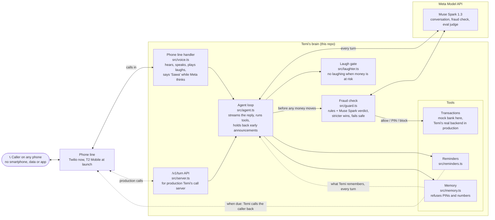

# Temi AI architecture

How a phone call becomes an answer, an action or a payment. The same diagram is in the [README](../README.md#how-a-call-flows).

**One turn, step by step:**
1. The caller speaks. The phone line turns it into text in their language and sends it to the brain, with their country (taken from the number) and the call so far.
2. The brain builds Muse Spark's instructions for this caller: their country's currency, languages, networks and scams, today's local date, and **everything Temi remembers about them**.
3. Muse Spark replies, sentence by sentence. If it hasn't started within 0.8s, the caller hears a short "Sawa" or "Okay" instead of silence.
4. If it decides to act, the tool runs:
   - questions need none;
   - reminders and memory are handled in the brain;
   - **any money tool first goes through the fraud check.** A second Muse Spark call reads the whole conversation for scams and pressure, the country's rules check amounts and new recipients, and the stricter answer wins. If the check times out, the payment needs a PIN instead of going through.
5. The reply is spoken. A `[chuckle]` or `[laugh]` plays as a real recorded laugh, unless the laugh gate removes it.
6. When a reminder comes due, the brain phones the caller back through Twilio, and the same loop runs with the reminder in context.

| Part | File |
|---|---|
| Agent loop: streams text, runs tools, loops until it has something to say | [src/agent.ts](../src/agent.ts) |
| Fraud check: rules + Muse Spark verdict, stricter wins, fails closed | [src/guard.ts](../src/guard.ts) |
| Country profiles: currency, networks, mobile money, languages, fraud limits, scams | [src/countries.ts](../src/countries.ts) |
| Meta Model API client (plain `fetch`, streaming) | [src/model.ts](../src/model.ts) |
| Tool definitions | [src/tools.ts](../src/tools.ts) |
| Reminders and the outbound calls that deliver them | [src/reminders.ts](../src/reminders.ts) |
| Memory: what Temi remembers about each caller, across calls | [src/memory.ts](../src/memory.ts) |
| Speech guards: amounts read back in digits, no internal notes or PINs spoken | [src/speech.ts](../src/speech.ts) |
| Laughter: when Temi may laugh, and the recorded laughs it plays | [src/laughter.ts](../src/laughter.ts), [assets/laughs/](../assets/laughs/) |
| Phone line: Twilio calls in and reminder calls out, straight into the brain | [src/voice.ts](../src/voice.ts) |
| Mock bank for local runs and evals (no real money) | [src/executors/mock-bank.ts](../src/executors/mock-bank.ts) |
| Forwarder to Temi's real banking backend | [src/executors/http.ts](../src/executors/http.ts) |
| HTTP/SSE server | [src/server.ts](../src/server.ts) |
| Evals | [evals/](../evals/) |
